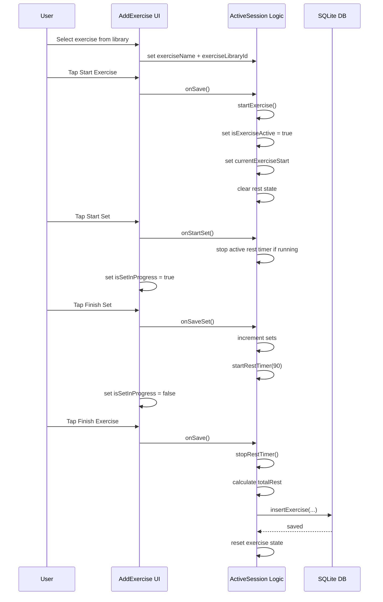
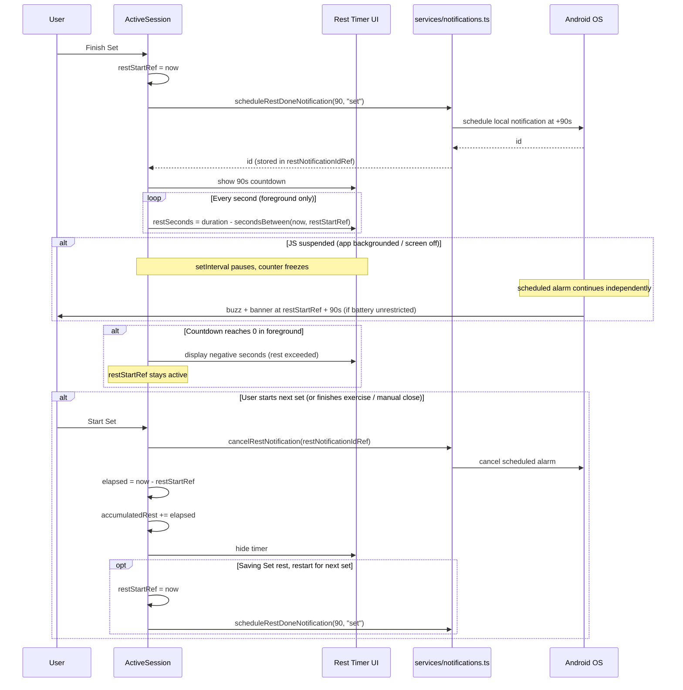
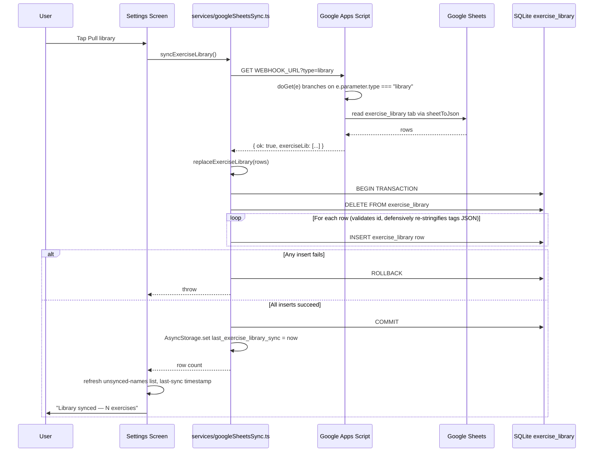
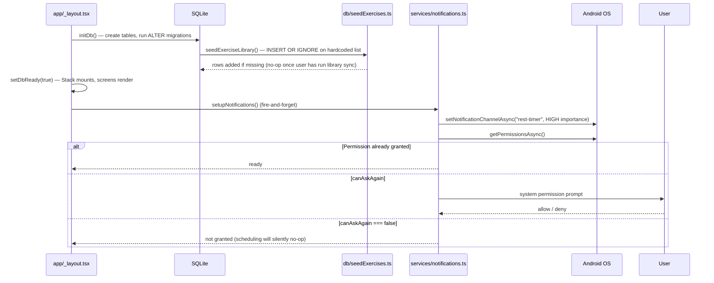
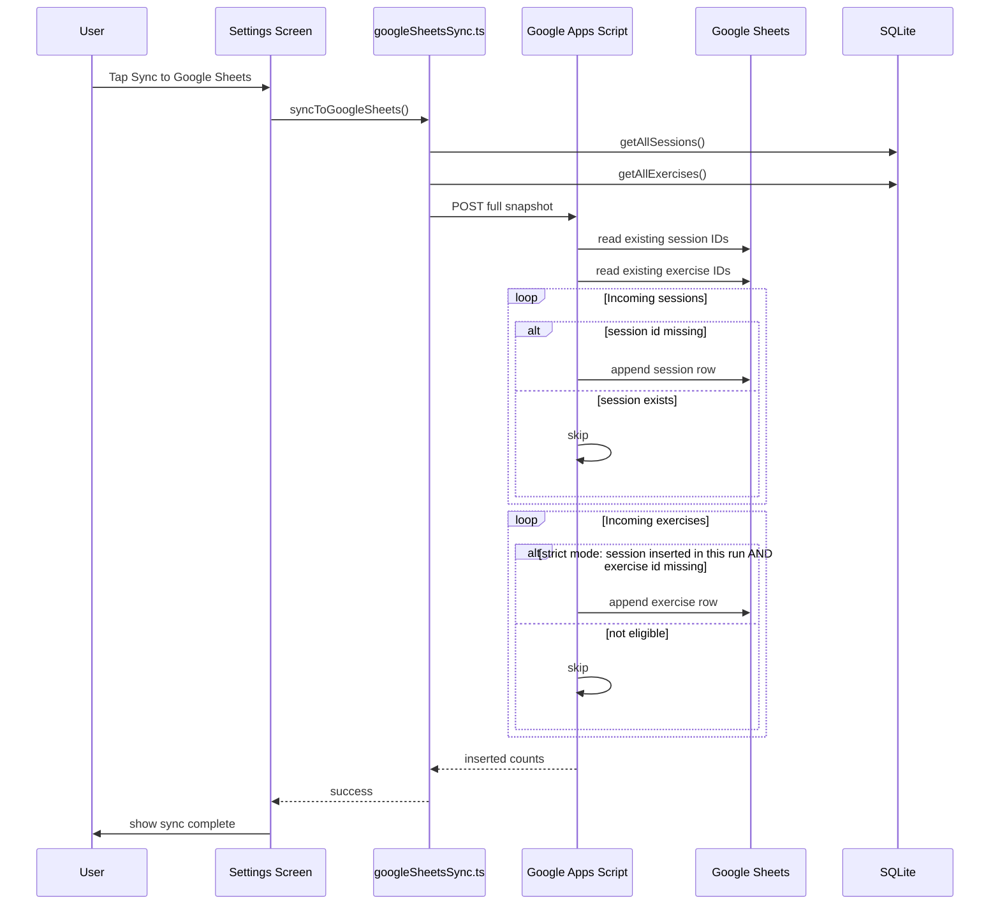

# Sadhana — Architecture, Features, and Current Status

*Sadhana* (साधना) is the Sanskrit term for a daily, disciplined practice — the work you return to until it becomes who you are. The app is named for the same intent applied to training: not a one-off workout logger, but the daily ritual.

## 1. Core Idea

A mobile-first gym logging application focused on:

- Fast, minimal friction workout tracking
- Accurate rest and session tracking
- Offline-first architecture
- Simple but extensible data model
- Google Sheets as external data/control layer (sync + CMS)

---

## 2. High-Level Architecture

### Layers

#### UI Layer (React Native / Expo)

- Screens: Exercises, Active Session, Settings
- Reads only from local SQLite
- No direct network dependency

#### DB Layer (SQLite)

- Source of truth during runtime
- Tables:
  - `sessions`
  - `exercises`
  - `exercise_library`

#### Service Layer

- Google Sheets sync (sessions + exercises)
- Exercise library sync (Sheets → SQLite)

#### External Layer (Google Sheets)

- Acts as:
  - Backup store
  - Data sync target
  - CMS for exercise library

---

## 3. Key Features Implemented

### 3.1 Workout Logging System

#### Flow

- Start Exercise
- Start Set
- Finish Set → triggers rest
- Start Set → stops rest immediately
- Finish Exercise → saves to DB

#### Important UX Decisions

- Explicit Start Set / Finish Set buttons
- Prevents accidental rest tracking
- Matches real gym behavior

---

### 3.2 Rest Timer System (Major Refactor)

#### Previous Problem

- Rest calculated using countdown logic
- Caused:
  - Lost rest data
  - Race conditions
  - Incorrect 0 values

#### Final Solution (Timestamp-Based)

- On rest start:
  - store `restStartRef = new Date()`
- On rest stop:
  - `elapsed = now - restStartRef`
  - accumulate into `accumulatedRest`

#### Behavior

- Countdown is visual only — its length is the per-exercise-type target (see §3.11; 90s for unknown types)
- After 0 → timer continues upward (+seconds)
- Rest ends ONLY when:
  - Start Set
  - Finish Exercise
  - Manual stop

#### Result

- Accurate rest tracking
- No data loss
- Works even with long rests

#### Background behavior (Android, current state, May 2026)

Target platform is Android. When the app is backgrounded (user switches apps, locks screen), Android suspends/throttles the JS thread — `setInterval` stops, JS-driven `Animated` pauses. The system handles this in three coordinated pieces, all keyed off `restStartRef`:

1. **Visible counter (`restSeconds`)** — every `setInterval` tick recomputes the displayed value as `duration - secondsBetween(new Date(), restStartRef.current)`, **not** `prev - 1`. So when JS resumes in the foreground, the next tick (within ~1s) snaps the counter to the correct elapsed value. Counter goes negative past 0 to indicate "rest exceeded". Don't refactor this back to decrementing — that's the broken pattern we replaced.
2. **OS-scheduled local notification** — `services/notifications.ts` schedules an `expo-notifications` time-interval notification at `restStartRef + duration` whenever rest starts. ID kept in `restNotificationIdRef`. Fires regardless of JS state — app backgrounded, screen off, app killed. Two kinds:
   - `"set"` (type target: 2:30 compound / 1:15 isolation / 1:00 cardio / 1:30 other) → title "Rest done", body "Time for your next set"
   - `"transition"` (120s) → title "Next exercise", body "Ready for the next exercise"
3. **Saved rest value** — `secondsBetween(new Date(), restStartRef)` accumulated into `accumulatedRest` on `stopRestTimer`. Wall-clock math, independent of JS thread state.

**Cancellation invariants:** at most one rest notification scheduled at any time. `startRestTimer` cancels any prior `restNotificationIdRef` before scheduling a new one. `stopRestTimer` cancels the saved ID. Every code path that ends rest goes through `stopRestTimer`.

**Notification handler:** `Notifications.setNotificationHandler` runs at module load in `services/notifications.ts`. Without it, `expo-notifications` suppresses banner/sound while the app is foregrounded — meaning the user wouldn't see the buzz if they were staring at the rest screen. Override forces show.

**Android battery optimization caveat:** Doze mode can delay scheduled-notification delivery by 10-30+ seconds when the device is idle. The user must mark the app as "Unrestricted" in system Settings → Apps → Sadhana → Battery for on-time delivery. We don't request `REQUEST_IGNORE_BATTERY_OPTIMIZATIONS` programmatically — that's a documented one-time per-device setup. OEM skins (Samsung, Xiaomi/MIUI, OnePlus, Realme) often add additional restriction layers that need separate whitelisting.

**Known cosmetic drift:** the breathing-cat ring (`Animated.timing` on `restRingProgress`) is JS-driven and pauses in background. After a long background, the ring animation will be out of sync with the numeric counter. Not blocking — counter is the actual signal.

---

### 3.3 Set Tracking UX

Layout during an exercise is built to avoid mis-taps (Oct 2026):

- **One big set button** (full width, tall) toggles `▶ Start Set N` (blue) ↔ `● Finish Set N · m:ss` (red). A second tap within 700 ms is ignored, so a double-tap can't finish a set and immediately start the next.
- **Finish Exercise is hold-to-confirm** (600 ms, fill animation + haptic), a smaller secondary button set apart below the note. A quick tap only shows "Keep holding to finish".
- **Undo**: after finishing, the newest card in "Exercises this session" gets a small `↩ Undo` pill (no extra row, no time limit). Undo deletes the saved row (`deleteExercise`) and restores the exercise exactly — name, note, reps/weight, completed sets, accumulated rest, a rest timer resumed from its original start (`startRestTimer(…, startedAt)`), or the in-flight set with its original start (`restoreSetState` prop on `AddExercise`). Anything Up next auto-loaded into the picker goes back to the front of the queue. Starting the next exercise or ending the session drops the undo.
- **End session** sits in the header row ("Started 18:02 · End session"), away from the set controls, and is **hidden while an exercise is running** — ending mid-exercise used to drop the unsaved exercise.

#### Finish Exercise auto-saves the in-flight set

If a set is mid-flight (`isSetInProgress` in `AddExercise.tsx`) when the user taps **Finish Exercise**, that set is counted as completed before the exercise is recorded — i.e. tapping Finish Exercise is treated as "Finish Set + Finish Exercise" in one gesture. The same PR check that runs in `saveSet()` also runs for the auto-saved set.

Why: previously, `finishExercise()` only read the `sets` counter, which is bumped exclusively in `saveSet()`. Habitual users would tap Finish Exercise on their last set without first tapping Finish Set, silently losing the set. The hold button's label flips to `Hold · finish set N & exercise` while a set is active so the behavior is visible; `canFinish` is also relaxed (`sets > 0 || isSetInProgress`) so the very first set can be auto-saved on a single-set exercise. Don't refactor `finishExercise` back to ignore the in-flight set without restoring an equivalent safety net.

#### Enhancements

- Animated set chips
- Visual feedback on set completion
- Minimal cognitive load

---

### 3.4 Exercise Library System

#### Source of truth

Google Sheets is canonical. The user maintains an `exercise_library` tab with columns `id | name | video_url | primary_muscle | tags` (where `tags` is a JSON-array string per cell). The app pulls this into the local `exercise_library` table on demand via `syncExerciseLibrary()`.

The hardcoded list in `db/seedExercises.ts` exists only as a first-install bootstrap — it runs via `INSERT OR IGNORE` inside `seedExerciseLibrary()` so it never overwrites synced rows. Once the user runs library sync, the seed is effectively replaced.

#### Schema

```
exercise_library
- id (TEXT PK)
- name (TEXT)
- video_url (TEXT, nullable)
- primary_muscle (TEXT)
- tags (TEXT, JSON-stringified)
```

#### Sync mechanics (Pass 2, May 2026)

- App calls `fetch(WEBHOOK_URL + "?type=library")` → Apps Script `doGet` branches on `e.parameter.type === "library"` and returns `{ ok: true, exerciseLib: [...] }`.
- `replaceExerciseLibrary()` in `db/exerciseLibrary.ts` runs `BEGIN; DELETE FROM exercise_library; INSERT ...; COMMIT;` (rolls back on any failure). **Full replace, no upsert** — Sheet wins, period.
- `tags` is round-tripped through `JSON.parse → JSON.stringify` defensively; malformed cells become `[]` rather than throwing.

#### Reconciliation: logged-but-not-in-library names

Pass 1 lets users log exercises with names not in the library; the session row stores the typed name as a synthetic `exercise_library_id`. `getLoggedExercisesNotInLibrary()` (in `db/exerciseLibrary.ts`) surfaces these on the Settings screen as a passive list ("Logged but not in library — add these to your Google Sheet's library tab, then sync."). It does **not** auto-write to the Sheet — the user copies them over manually and runs library sync.

#### Entry points

- App boot: `seedExerciseLibrary()` runs as part of `initDb()`. Idempotent.
- Settings → "Sync exercise library" button: pulls from Sheet and full-replaces local table.

---

### 3.5 Google Sheets Sync (Sessions + Exercises)

#### Behavior

- App sends full SQLite snapshot
- Sessions are sent oldest-first (sorted in `syncToGoogleSheets`; `getAllSessions()` itself stays newest-first for the UI) because the Apps Script appends in received order — before Oct 2026 multi-session pushes landed newest-first in the Sheet
- Apps Script handles deduplication

#### Deduplication

- Based on ID matching
- IDs normalized to string

#### Strict Mode (Implemented)

- Only insert sessions not present
- Only insert exercises for newly inserted sessions

#### Debug System

- Temporary debug flag added
- Returned:
  - existing counts
  - incoming counts
  - inserted counts

Used to validate correctness.

---

### 3.6 Settings Page

#### Layout (May 2026 refresh)

Settings is sectioned and uses two horizontal button rows instead of stacked full-width buttons. Each button is a two-line label (action verb on top, context line below) at compact font sizes (13/10) so all three sync actions fit on a phone width.

```
[Sync not configured banner — only if env vars missing]

Local backup
[ Export ]   [ Share ]
  save JSON   send backup

Google Sheets
[ Push history ]  [ Restore history ]  [ Pull library ]
   ↑ to Sheets       ↓ from Sheets        ↓ from Sheets

History last pushed: …
Library last pulled: …

Open spreadsheet ↗   ← only if EXPO_PUBLIC_GSHEETS_SPREADSHEET_URL set

Logged but not in library (n)
  · <name> (count×)
  …

[Show Debug JSON]   ← dev panel, sessions/exercises raw dump
```

#### Features

- **Export** — write a local JSON backup file (works with no env vars).
- **Share** — same export, then share-sheet via `expo-sharing`.
- **Push history** (`syncToGoogleSheets`) — POST sessions + exercises snapshot to Apps Script.
- **Restore history** (`restoreFromGoogleSheets`) — non-destructive merge (Oct 2026): adds Sheet sessions/exercises missing on the phone (by id), copies the Sheet's `gym` onto matching sessions (Sheet wins), never deletes or otherwise overwrites phone rows. Returns counts shown in the alert. `exercise_library` left intact. (It used to wipe and re-import, which lost anything the Sheet lacked.)
- **Pull library** (`syncExerciseLibrary`) — GET `?type=library`, full-replace local `exercise_library`.
- **Open spreadsheet** — `Linking.openURL` to `EXPO_PUBLIC_GSHEETS_SPREADSHEET_URL`. Only renders if the env var is set.
- **Logged but not in library** — passive list from `getLoggedExercisesNotInLibrary()`. Surfaces names typed into a session that don't match any library row, prompting the user to add them to their Sheet manually then pull.
- **Sync not configured banner** — `isSyncConfigured()` returns false → red banner explains the env var is missing. Sync still attempts, but the user is told upfront the build is broken.

#### Focus refresh

`useFocusEffect` re-reads last-sync timestamps and the unsynced-names list every time the Settings tab gains focus, so logging an unknown exercise → switching tabs → coming back to Settings shows the new entry without an app reload. Same pattern is used in `components/ActiveSession.tsx` (library names for suggestion chips) and `app/(tabs)/exercises.tsx` (the library-listing screen).

---

### 3.7 Exercises tab: done / not-done hints + history

Every library row shows an all-time status line from `getExerciseLogSummaries()` (one `GROUP BY exercise_library_id` query, re-read on focus): `● Logged N× · 3d ago` or `○ Not done yet`. Logged rows show a `›` and tapping the row opens `/exercise-details` (same screen as from Session details). Keyed by `exercise_library_id`, same as `getExercisesByLibraryId`, so the count matches the history screen. Rows never logged aren't tappable.

A filter icon next to the search bar opens two toggle chips — `○ Not done yet (n)` and `⏳ 2+ weeks ago (n)` — that narrow the list by that same summary (never logged / last logged ≥14 calendar days ago). They combine with the muscle filter and search; counts follow the selected muscle. "2+ weeks" sorts longest-neglected first. The icon shows a dot while a filter is on; with the panel closed, only the active chip stays visible (with ✕). Arriving from Home's Today's focus resets it to all.

### 3.8 Up Next Queue (Exercises tab → active session)

While a session is open (`getActiveSession()` returns a row), every Exercises-tab row gets a ＋ button. Tapping it queues the library exercise for the session; tapping the `#n` badge again removes it. Exercises already logged this session show `✓ this session`; the one in the Home picker shows `NOW` (running) or `NEXT` (selected, not started).

- **Store:** `hooks/use-up-next.ts` — module-level store read via `useSyncExternalStore`, keyed to the session id and persisted to AsyncStorage (`up_next_queue_v1`) so it survives Android killing the app. Cleared on Confirm & Save / Discard.
- **Auto-load into the picker** (`ActiveSession.tsx`) happens only when (a) an exercise just finished, or (b) something was just queued — and only if no exercise is running and the picker is empty. It never starts an exercise, never overwrites a typed/picked name, and doesn't fire when the user clears the picker by hand. Rest/transition timers are untouched.
- **Up next strip** on Home: chips under the Add exercise card. ✕ removes; tapping a chip between exercises swaps it into the picker (a not-yet-started library pick goes back to the front of the queue).

### 3.9 "Try today" progression target

When an exercise with history is picked, a 🎯 chip sits next to "Prev logged" in `AddExercise` (live mode only): `🎯 Try 8×62.5kg · tap`, with a one-line reason under it. Tapping applies the reps/weight; it never overwrites them on its own. Once the steppers match, it flips to `🎯 On target`.

- Rules live in `domain/progression.ts` (`suggestNext`, pure) over the last 3 non-discarded logs (`getRecentExerciseRows` in `db/exercises.ts`): stalled 3× or held twice at the same weight → +2.5 kg (or +5 lb in lb mode); reps dipped at the same weight → repeat and hit the previous reps; new/heavier weight or a single log → +1 rep; bodyweight → +1 rep.
- Limitation: the schema stores one weight × reps per exercise row, not per set, so "all sets hit target" can't be checked — rules compare whole sessions.

### 3.10 Today's focus (Home, before Start session)

A single pill above "Start session" — `🎯 Today: Back + Biceps ›` (`Next:` if already trained today, `⚠` if coming back from a break) — keeps Home uncluttered. Tapping it opens a bottom sheet (`components/home/TodayFocusCard.tsx`) with the reason ("Next in your rotation · last done 5 days ago"), the comeback note, and a chip per regularly-trained muscle with days since last trained (`recovering` if today/yesterday). Tapping a muscle opens the Exercises tab pre-filtered to it (`/exercises?muscle=…&t=…`).

- Data: `getTrainingLog()` in `db/sessions.ts` — finished, non-discarded, non-sauna sessions with their confirmed `session_labels`, falling back to the logged exercises' library `primary_muscle` when a session has no labels.
- Logic: `computeTodayFocus()` in `domain/todayFocus.ts` (pure, `now` injectable). Window = 8 weeks before the **last** session (not before today), so long breaks don't erase the pattern. **Split mode** when repeated muscle combos (≥2× each) cover ≥60% of the window → suggest the combo done longest ago whose muscles aren't recovering (continues the rotation). Otherwise **muscle mode** → longest-gap regular muscle + its most frequent partner. Cardio/Sauna ignored. Breaks of 7+ / 21+ days add a "go lighter / ease back in" note.
- Shown only in idle mode; recomputed on Home focus and when a session ends.

### 3.11 Rest target by exercise type + per-set rest log

- **Target**: after Finish Set the countdown uses `restTargetFor(tags)` from `domain/restTarget.ts` — library tag `compound` → 2:30, `isolation` → 1:15, `cardio` → 1:00, else 1:30. The rest header reads e.g. `🧘 REST · 2:30 compound`, and the "Rest done" notification fires at that point. It is only a target: actual rest is still wall-clock, so going over/under never loses data. (Chosen over learning from the user's own history, Oct 2026.)
- **Per-set rest log**: new column `exercises.rest_periods` (JSON array of seconds, default `"[]"`, added via `ensureColumn`). `stopRestTimer(true)` appends the elapsed rest only when it ends a between-set rest (next set started or Skip rest) and the running rest was a `"set"` rest (`restKindRef`). The trailing rest before Finish Exercise and the transition rest before an exercise are excluded. `rest_seconds` keeps its old meaning (total, which also includes the preceding transition rest).
- Undo restores the log; Sheets push sends `rest_periods` (the Apps Script writes it under its own header, see §3.13); restore parses it back via `parseRestPeriods`.

### 3.12 Per-set log (reps × weight per set)

- New column `exercises.set_log` (JSON, default `"[]"`): one `{reps, weightKg, weightUnit, durationSec}` per set, captured at Finish Set from the steppers at that moment (`logSet` in `ActiveSession`; `AddExercise.onSaveSet(setStartedAt)` passes the set start for the duration). Hold-to-finish with a set in flight logs that set too. The row's `reps`/`weight_kg` keep their meaning (= last set), so PRs, charts and 🎯 Try today are unchanged.
- **Live**: the `Set N` chips stay and show the set's duration (`Set 1 · 0:38`, from `durationSec`); each set is one column — chip, reps × weight under it, then the rest after that set in blue (`💤1:35`, `rest_periods[i]`). The strip is a single sideways-scrolling row that never wraps and auto-scrolls to the newest set. The running set shows the current stepper values under it. Shared pieces live in `components/SetBreakdown.tsx` (`SetColumn`, `RestGap`, `formatSetLoad`).
- **Static** (`<SetBreakdown>` in Session details and exercise history): same layout, smaller. Hidden for older rows without a log, and for rows edited afterwards (set count differs, or last set ≠ row reps × weight).
- Undo restores the log; Sheets push sends `set_log` (written by header, see §3.13); restore parses it back.

### 3.13 Apps Script (Sheets side) — `apps-script/Code.gs`

The web-app script lives in the repo at `apps-script/Code.gs` (constants `SHARED_SECRET`, `SPREADSHEET_ID`, `SHEET_*` stay in a separate file in the Apps Script project — never commit them; the repo is public). Deploy by pasting it over `Code.gs` in the editor → Deploy → Manage deployments → ✏️ Edit → **New version** (keeps the same `/exec` URL the app has in `.env`).

- `doPost` writes the original 11 exercise columns positionally (unchanged), and newer fields (`EXTRA_EXERCISE_FIELDS`: `weight_unit`, `rest_periods`, `set_log`) **by header** — `ensureHeaders()` creates any missing header after the last used column on the next push. To sync a new exercise field: add it to the app payload and to `EXTRA_EXERCISE_FIELDS`.
- Append-only: existing rows are never rewritten, so edits/Undo/deletes after a push don't reach the Sheet.
- Known gap: `doGet` (restore + library) does not check the secret.
- Before Oct 2026 (v10 and earlier) `weight_unit` was silently dropped by the positional append; rows pushed before v11 have no `weight_unit`/`rest_periods`/`set_log`.

### 3.14 Data migrations + Oct 2026 library cleanup

- `db/migrations.ts` holds one-time **data** fixes, run from `initDb()` after the schema/seed and tracked with `PRAGMA user_version` (each runs once per install, inside a transaction, and never re-applies over later edits). Schema changes still go through `ensureColumn` in `schema.ts`.
- `user_version 1` — library cleanup: 13 exercises logged under names that weren't in the library are relinked (by exercise id) to their library entry. The Sheet side is `apps-script/Cleanup_2026_10.gs` (`cleanupLibrary_2026_10`, run once from the editor, `DRY_RUN` first); it also fixes Barbell Shrug → Traps, Deadlift → Back, adds `machine` to Seated Dip / Arm Extension, and adds 8 library entries (Cable Front Raise, Seated Cable Row (Narrow Grip), Cable Bicep Curl, Cable Wrist Curl, Cable Upright Row, Cable Shrug, Hack Squat Machine, Shoulder Press Machine). The two mappings must stay identical.
- Library conventions: `id` lower_snake_case and **never changed** (history links to it); `name` Title Case with variants in brackets; `primary_muscle` one of Back, Chest, Shoulders, Biceps, Triceps, Legs, Core, Traps, Forearms, Cardio; `tags` = `[push|pull|core, muscle, compound|isolation, equipment, sub-muscles…]`.

### 3.15 Movements, equipment variants and gyms (Oct 2026)

Training at different gyms means the same exercise is done on different equipment, and machine weights aren't comparable between gyms.

- **Movement vs variant.** A library row is a *variant* (Barbell Squat, Hack Squat Machine…); rows sharing the Sheet column `movement` form one *movement* ("Squat"), shown by `movement_name`, with `variant` as the chip label. Empty `movement` → its own single-variant movement. Ids never change. Helpers: `domain/movement.ts` (`equipmentOf(tags)`, `isGymScoped`, `weightUnitSuffix`), `groupMovements()` in `db/exerciseLibrary.ts`. Grouping was seeded by `apps-script/PrefillMovements_2026_10.gs`; new library rows should fill the three columns by hand.
- **Picker.** Search lists one entry per movement (matches movement + variant names). Picking one selects the variant last used at this gym (`getLastUsedVariant`, else most recent anywhere, else first); equipment chips switch variant before the exercise starts, hidden once running (no mid-exercise switching). Logged rows keep the variant's own name/id, so per-variant history works unchanged.
- **Gym per session.** `sessions.gym` ('' = unknown), picked via the 📍 pill above Start session (`components/home/GymPicker.tsx`, remembered in `services/gymPreference.ts`). Synced by header (`EXTRA_SESSION_FIELDS` in `apps-script/Code.gs`).
- **Comparisons.** Free weights (barbell, EZ-bar, dumbbell, bodyweight) use history from all gyms. Machine / cable / Smith use only this gym's history for Prev logged, 🎯 Try today and PRs, with a labelled fallback to another gym ("@ Gym B", "Other gym's machine — …"); a first time on this gym's machine is not a PR. Sessions without a gym don't scope.
- **Dumbbells** are logged per dumbbell and shown as `kg/db`.
- **Exercises tab** shows one row per movement with equipment chips (logged ones bright with counts → that variant's history). **History** (`app/exercise-details.tsx`) loads all variants of the movement (`getExercisesByLibraryIds`) with `All · Barbell · Dumbbell…` tabs; stats + chart render only for a single variant so weights are never mixed; entries show variant and 📍 gym.

### 3.16 Patterns: avoid doubling up on the same job (Oct 2026)

Logs showed 18/50 sessions with two different movements doing the same job (e.g. Bent-Over Row + Seated Row: 11×) and 15/50 with the same movement on two pieces of equipment, while patterns like lat isolation / rear delts / overhead triceps were rarely trained.

- Library column `pattern` (seeded by `apps-script/PrefillPatterns_2026_10.gs`, 36 patterns, editable in the Sheet): what a movement trains within its `primary_muscle` ("Horizontal row", "Vertical pull", "Fly", "Pushdown / kickback"…). Empty → the movement is its own pattern.
- `domain/patternCoverage.ts`: `sessionCoverage()` (per muscle trained this session: each library pattern with how often it was hit) and `overlapHint()` (picked exercise repeats a pattern already done). Cardio ignored. Hints only — nothing is blocked.
- Active session: an amber line under the picked exercise ("⚠ Horizontal row already done today (Seated Row) · Not done yet: Lat isolation · …") and a coverage line per muscle (✓ done, ✓2 doubled in amber, ○ open) above "Exercises this session".
- Exercises tab: within each muscle, movements are grouped under a pattern sub-header (not when sorting by "2+ weeks ago").
- Pattern filter: with a muscle selected, the ☰ filter panel shows that muscle's patterns as chips (`Horizontal row (4)`); one tap shows only that pattern. Resets when the muscle changes; while the panel is closed an active pattern stays visible as one chip with ✕, and the filter icon shows its dot.

### 3.17 Data audit fixes + weight conventions (Oct 2026)

An audit of logs vs library (all rows linked; no orphans/duplicates/impossible values) found three kinds of drift, fixed by `apps-script/FixFromNotes_2026_10.gs` on the Sheet and `user_version 2` in `db/migrations.ts` on the phone (identical mappings; verified to give the same 52 session labels and 333 exercise rows):

- **Wrong equipment, per the exercise's own note** ("dumbbell", "with cables", "seated dip", "barbell, total 40"…): 9 rows relinked to the right variant (one also gets weight 40), 3 variants added to the library (Decline Press · Barbell, Overhead Triceps Extension · Cable Straight Bar, Front Raise · Barbell); 2 rows named "dips" → "Dips".
- **Session labels**: legacy Quadriceps / Hamstrings / Glutes / Calves → Legs, and muscles trained but not labelled are added (`cleanSessionLabels` in `domain/muscles.ts`; labels are only added, never removed; Sauna untouched). `getTrainingLog()` (Today's focus) now always uses labels ∪ logged muscles through the same rule.
- **Weight conventions**: dumbbells per dumbbell (`kg/db`), iso-lateral machines (tag `iso-lateral`) per side (`kg/side`, "per side" next to the kg/lb toggle) — `weightUnitSuffix()` in `domain/movement.ts`. Historic per-side vs total entries were not rewritten.

### 3.18 Weekly sets per muscle (Oct 2026)

The 🎯 Today's focus sheet has a "Sets this week (last 7 days) · target 10–20" section: one bar per muscle (green inside 10–20; amber + the word "low"/"high" outside, so it's never colour-only), a faint 10–20 band behind the bars, and muscles you train regularly listed even at 0. Tap a muscle → Exercises tab filtered to it. Data: `getSetsByMuscleSince(7)` in `db/sessions.ts` (sum of `sets` by library `primary_muscle`, discarded/sauna excluded); shaping/zones in `domain/weeklyVolume.ts`. Nothing new on Home itself.

### 3.19 Build today's session (Oct 2026)

Goal: when a muscle is trained twice a week, the two sessions should cover different patterns (like a coach's strength/hypertrophy split) instead of repeating the same rows.

- `domain/sessionBuilder.ts` `buildSession(muscles, library, log, gym, now)` — for each Today's focus muscle, ranks its patterns (isometric holds always last; then not done in the last 7 days first; compound before isolation; fewest weekly sets) and takes 3 for Back/Chest/Legs/Shoulders, 2 for smaller muscles. Per pattern it picks a variant not used this week if possible, scoring + used at this gym, + used before, + days since last used. Each pick carries a one-line reason ("hinge · not done this week", "row · Cable this week → Machine").
- Data: `getLogEntriesSince(120)` (library id, start, gym, sets of non-discarded sessions) + the library; computed on Home focus and when the gym changes.
- UI: "Suggested session" section in the 🎯 sheet ("Suggested next session" once you've trained today — it counts today's work too): ✕/↺ per item, "▶ Start session with these (N)" starts a session at the selected gym and fills Up next with the exact variants (first one auto-loads into the picker). The plain Start session button is unchanged.

Bottom sheets (`components/ui/BottomSheet.tsx`) can be swiped down to close: a PanResponder on the sheet captures clear downward drags when the content is scrolled to the top (otherwise the ScrollView keeps the gesture); > 110 px or a fast flick closes, a short drag springs back; disabled while `raised`.

### 3.20 Home layout (idle), Oct 2026

Kept to five rows: title + tagline · one quiet line "🔥 3-day streak · 📅 4 this week" (was two chips) · the 🎯 Today's focus pill · one row with the Start session button and, beside it, a separate 📍 gym button (`GymPicker` with a custom `renderTrigger`) — kept apart so changing the gym can't start a session by accident · a small "+ log sauna" link. "Ready to train" was removed. Recent sessions follow.

### 3.21 Polish pass (Oct 2026)

- **Removed:** Expo template leftovers (hello-wave, themed text/view, collapsible, use-theme-color), History's Refresh button (it reloads on focus), the Settings Debug JSON button (long-press the version pill instead). Success pop-ups became a toast (`components/ui/Toast.tsx`, `useToast()`); errors stay as Alerts.
- **Feel:** light haptic on set taps, success haptic on a PR, a warning buzz once when the rest target is reached; the rest ring goes yellow → orange (≤ 10 s) → red (over); `LayoutAnimation` when exercises finish/undo and Up next changes.
- **Readability:** no text below 12 pt, greys lightened (`#555/#666 → #888`, `#777 → #999`), bigger tap areas on small buttons.
- **Session saved screen** shows a summary: minutes · exercises · sets, the muscles you confirmed, and up to 3 PRs hit this session (tracked in `sessionPrsRef` when the PR badge fires).
- **History:** month headings (SectionList), discarded sessions hidden (still in the DB/Sheet), each card shows the 📍 gym, a 12-week consistency grid pinned above the list (`components/ConsistencyDots.tsx`: a column per week, M–S labels down the side; a day with a workout is green, brighter for more sets (< 12 · 12–17 · 18–22 · 23+, from `getSetTotalsBySession`); sauna-only days don't count. Tap a day → one line under the grid with muscles · sets · minutes · gym (or "rest day"); otherwise that line shows the shade legend. Stats: days in 12 weeks, weeks with 3+ days out of 12, days this week).
- **Last note:** under Prev logged / Try today, `📝 <note> · <date>` shows the newest non-empty note written on that exercise (`getLastNoteByName`), even if the last session had none — for machine settings, grips, pain. Gym-scoped equipment looks at this gym first, then any gym (labelled `@ gym`). Hidden when there's no note.
- **Resume screen** (`PendingMode`) shows how long ago the session started and what's already logged (`N exercises · N sets: names…`).

---

## 4. Important Architectural Decisions

### 4.1 Offline-First Design

- App never depends on network during workout
- All reads from SQLite
- Sync is async and optional

### 4.2 Separation of Concerns

| Layer    | Responsibility   |
| -------- | ---------------- |
| UI       | Rendering only   |
| DB       | Storage          |
| Services | Network + sync   |

### 4.3 Google Sheets as canonical store

Google Sheets is the source of truth for two things:
- **Sessions + exercises archive** — the app POSTs every logged session to Apps Script, and `restoreFromGoogleSheets` can rebuild the local DB from there.
- **Exercise library** — the user maintains the library tab in the Sheet directly; the app pulls it via `syncExerciseLibrary` (full-replace).

This means the user can edit the library outside the app and have changes propagate on next sync — no app rebuild needed.

### 4.4 Fail-Safe Sync

- Sheets sync is a single POST; failure leaves local DB untouched.
- Restore merges inside one transaction: `insertSessionRaw` / `insertExerciseRaw` only for ids not on the phone, `setSessionGym` for Sheet gyms; nothing is deleted. The `exercise_library` table is left intact.

---

## 5. Current Status

### Completed

- Rest timer (timestamp-based, self-correcting visible counter on background→foreground resume)
- Rest-timer notifications via `expo-notifications` (set rest 90s, exercise transition 120s, foreground display enabled)
- Set tracking UX
- Exercise logging (including unknown names — Pass 1, May 2026)
- Google Sheets sync for sessions + exercises (stable, with strict dedupe)
- Exercise library sync (Sheets → DB, Pass 2, May 2026) + logged-but-not-in-library nudge
- Restore-from-Sheets flow (sessions/exercises only; library untouched)
- Settings UX refresh: sectioned layout, three-button sync row, "Sync not configured" banner, "Open spreadsheet" link
- Focus-based refresh of library data (Home active session, Settings, Exercises tab)
- Screen kept awake for the whole active session (`useKeepAwake` in `ActiveSession.tsx`; released on save/discard)
- Debugging system (used and removed)

### Stable Areas

- DB schema
- Sync pipeline
- Rest tracking
- UI interaction model

---

## 6. Known Tradeoffs

### Current Approach

- Full snapshot sync instead of delta

**Pros:**

- Simple
- Reliable

**Cons:**

- Sends redundant data

---

## 7. Future Improvements (Not Yet Implemented)

### Data Layer

- Delta sync for sessions/exercises (based on timestamps) instead of full snapshot
- "Promote to library" auto-write: skip the manual copy step by POSTing logged-but-not-in-library names directly into the Sheet's library tab

### UX

- Rest timer color change after threshold (e.g. red after 0)
- Haptic feedback on set completion
- Active set highlighting
- Quick rest-time picker (60/90/120/180s) instead of fixed 90s/120s
- Warmup-set toggle so warmups don't pollute PR / volume calculations
- Plate calculator (target weight → bar load breakdown)

### Performance

- Memoized DB reads
- Pagination for large datasets

### Notifications

- Re-anchor the breathing-cat ring animation from `restStartRef` so it doesn't drift on long backgrounds
- Programmatic prompt to disable battery optimization (via `expo-intent-launcher` to open the system page) so the user doesn't have to be told manually

---

## 8. Key Files Overview

### Core

- `ActiveSession.tsx` → rest + set logic
- `AddExercise.tsx` → set UX

### DB

- `db/exerciseLibrary.ts`
- `db/seedExercises.ts`

### Services

- `services/googleSheetsSync.ts` — sessions + exercises POST sync, GET-based restore, library sync via `?type=library`, plus `isSyncConfigured()` and `getSpreadsheetUrl()` helpers for the Settings UI.
- `services/notifications.ts` — `expo-notifications` wrapper. Configures the rest-timer Android channel + permission request (`setupNotifications`, called from `_layout.tsx`), exposes `scheduleRestDoneNotification(seconds, kind)` and `cancelRestNotification(id)`, sets a foreground notification handler at module load.

### UI

- `app/(tabs)/exercises.tsx`
- `app/(tabs)/settings.tsx`

---

## 9. Mental Model for New Developers

- SQLite is the runtime truth
- Google Sheets is external sync + CMS
- UI never talks to network directly
- Rest timing is timestamp-based, not timer-based
- Sync is append-only for sessions
- Library sync is replace-all

---

## 10. Sequence Diagrams

### 10.1 Active Exercise + Set Flow



---

### 10.2 Rest Timer Flow



---

### 10.3 Exercise Library Sync Flow



---

### 10.4 App Boot Flow



(There is no auto-sync of the library on boot — `seedExerciseLibrary` only fills empty rows from the hardcoded list. The user pulls the canonical library from Sheets manually via Settings → Pull library. Earlier drafts of this doc described an `ensureExerciseLibrary()` flow; that code never landed.)

---

### 10.5 Google Sheets Workout Sync Flow



---

### 10.6 Restore from Google Sheets Flow

```mermaid
sequenceDiagram
  participant User
  participant SettingsUI as Settings Screen
  participant SyncService as services/googleSheetsSync.ts
  participant AppsScript as Google Apps Script
  participant Sheets as Google Sheets
  participant SQLite as SQLite
  User->>SettingsUI: Tap Restore history
  SettingsUI->>User: "adds what's missing + gyms, deletes nothing" alert
  User->>SettingsUI: Confirm
  SettingsUI->>SyncService: restoreFromGoogleSheets()
  SyncService->>AppsScript: GET WEBHOOK_URL (no params)
  AppsScript->>AppsScript: doGet(e) — default branch (no e.parameter.type)
  AppsScript->>Sheets: read sessions + exercises + exercise_library tabs
  Sheets-->>AppsScript: rows
  AppsScript-->>SyncService: { sessions, exercises, exerciseLib }
  Note over SyncService: only sessions + exercises are used; exerciseLib is ignored here<br/>(library is managed via the dedicated Pull library action)
  SyncService->>SQLite: merge in one transaction — insert missing ids,<br/>copy Sheet gyms (nothing deleted, library untouched)
  loop sessions
    SyncService->>SQLite: insertSessionRaw(row)
  end
  loop exercises
    SyncService->>SQLite: insertExerciseRaw(row)
  end
  SyncService-->>SettingsUI: done
  SettingsUI->>User: "Restore complete"
```

---

## 11. Summary

The system has moved from:

> "UI-driven + hardcoded data"

→ to

> "Data-driven + offline-first + externally controlled"

It is now stable enough for real usage and extensible for future features.
